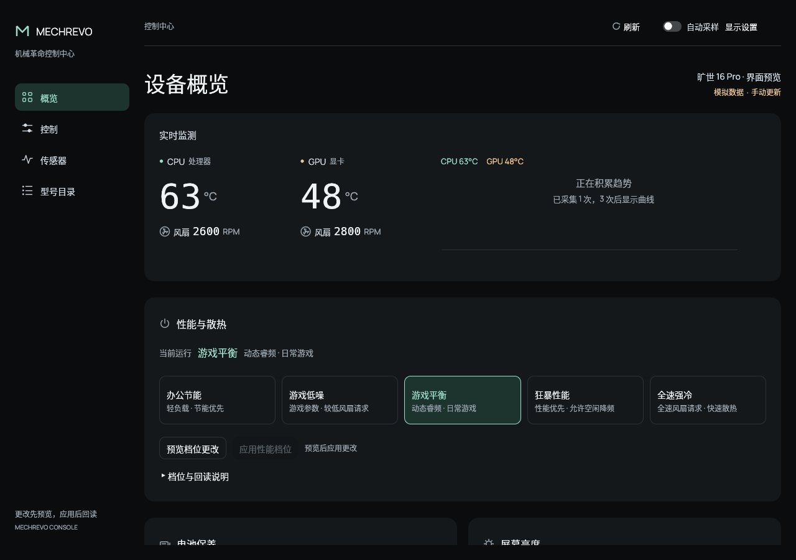

# 原生控制台

Windows / Linux 共用 Rust 核心，界面使用 eframe / egui 0.37；GUI 需要 Rust 1.95 或更新版本。



[浅色界面](../../screenshots/overview-light.png) · [截图与验收记录](../../VISUAL-REVIEW.md)

```sh
cargo run --manifest-path console/Cargo.toml -p mechrevo-console-gui --features gui
```

默认窗口 1280×900，最小 360×280。近黑与浅色主题共用简洁布局，支持文字缩放和关闭动画。宽窗使用侧栏，窄窗使用顶部导航；导航始终可见，小窗口中的刷新和显示设置随正文滚动。

首页依次展示温度与风扇、性能档位、电池保养与屏幕亮度、常用控制。传感器页可展开完整来源；型号目录提供产品资料，控制能力以运行时检测为准。布局约定见 [界面设计](../../DESIGN.md)，平台与机型支持见 [OEM 功能覆盖](../../../docs/OEM-FEATURE-COVERAGE.md)。

启动只读设备信息，不申请管理员权限。操作须先预览、再显式应用，后台重新校验并回读；切换目标或手动刷新会作废原预览。写入、回读或恢复未结束时延后关窗。

自动采样默认开启，每次至少间隔 3 秒，待确认预览期间暂停。温度历史按设备和来源隔离，每个来源最多 120 点；缺失读数留空，不补零。主题、文字缩放、信息密度、采样和动画偏好会保存，历史和操作计划不保存。

## 界面验证

```sh
# 状态与后台线程回归，不构建原生 GUI
cargo test --manifest-path console/Cargo.toml -p mechrevo-console-gui --lib

# 中文字体、布局、DPI、键盘交互与写事务生命周期
cargo test --manifest-path console/Cargo.toml -p mechrevo-console-gui --features gui

# 使用明确标注的测试数据运行原生界面，不访问硬件
cargo run --manifest-path console/Cargo.toml -p mechrevo-console-gui --example ui_preview --features screenshot
```

`ui_preview` 仅用于开发验收，常规程序不加载模拟数据。布局测试可通过 `MECHREVO_GUI_CAPTURE_DIR` 输出软件渲染图，用 `MECHREVO_GUI_CAPTURE_MATCH` 按文件名筛选截图。

截图和布局通过不代表硬件控制已验收。亮度回读可能来自驱动缓存，不能当成实测亮度；Windows 编译通过也不能代替 Windows 实机验证。
